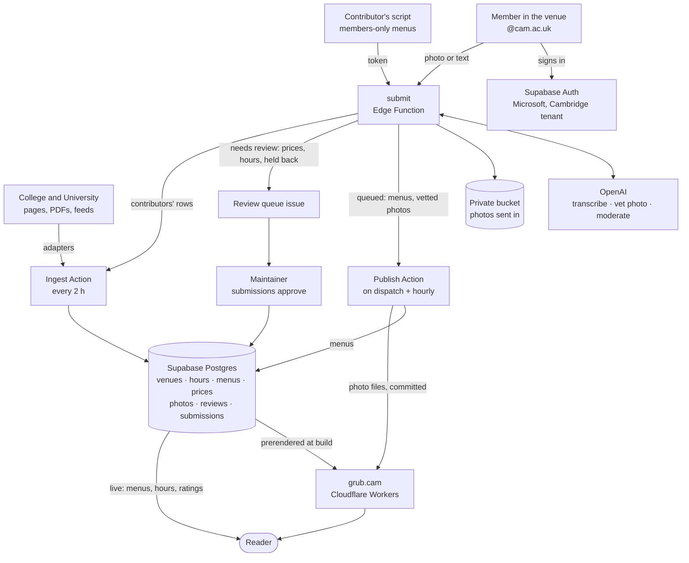

# grub.cam: Cambridge college menus, live

**Where can I eat in Cambridge right now, and what's on?**

Grub lists the dining halls, cafés and bars of all 31 Cambridge colleges, and the University's own cafés and canteens (West Cambridge, Sidgwick, the UL, the museums and more), with opening hours, prices and the menu dish by dish wherever one is published. What's open now comes first; filter by type, college or site, meal or diet, or search for a dish.

[](https://grub.cam)

Live at [grub.cam](https://grub.cam). See [AGENTS.md](AGENTS.md) for the data model, conventions and every command, and [CONTRIBUTING.md](CONTRIBUTING.md) for ways to help.

## How information gets in

Two routes fill the same Supabase database. Menus a college or the University publishes on the open web are fetched by scripts. Everything else (members-only menus, price lists, opening hours, photos of venues) comes from members of the University standing in the venue, signed in with their Cambridge account. A model reads what they send, and what goes up straight away is limited to what a check can vouch for.



What happens to each thing a member sends, from [`/send`](https://grub.cam/send) or a gap on a venue's page:

| Sent in | The model | Then |
|---|---|---|
| **Menu** (photo of the board, or typed) | Transcribes it into the menu text format; the sender checks and fixes it | Up within minutes when it parses, is for that venue, is dated yesterday to a week ahead, the venue's menu isn't scripted and the sender has sent fewer than 6 that day; otherwise a person looks |
| **Price list**, **hours** | Transcribes them; the sender checks | A person approves (`npm run submissions -- approve <id>`) |
| **Photo of the venue** | Checks it's a real photo of the venue with no recognisable face, and writes its alt text | Up within minutes when it passes (3 a day per member, 1 a day per venue), credited to the member's name under CC BY 4.0; the venue keeps its old photo until the new one's files are deployed |
| **Review** (1–5, optional words) | A rating alone goes straight up; words go through OpenAI's moderation and a check that they're about the venue and name no one | Shown anonymously once a venue has 5 |
| **Something else** | — | A person reads it |

Nothing a model is unsure of goes up unseen: whatever doesn't pass waits, with the reason, in the [Review queue](../../issues?q=is%3Aissue+is%3Aopen+%22Review+queue%22) issue. Model calls are logged with their cost; spending is limited by the OpenAI project's monthly budget, and once that's spent, what's sent in waits for a person.

## Run it

```sh
npm install
cp .env.example .env   # add the Supabase URL and publishable key
npm run dev
```

`npm test`, `npm run typecheck`, `npm run lint`; `npm run build` prerenders every page from live data.

## Switching on sending in

Reading needs no account and no keys beyond the publishable one. Sending in needs three things set up once:

1. **Microsoft sign-in.** In [portal.azure.com](https://portal.azure.com) → Microsoft Entra ID → App registrations → New registration: any name; supported account types *Accounts in any organizational directory (multitenant)*; redirect URI, platform Web, `https://leghyhbkovkyipgoygko.supabase.co/auth/v1/callback`. Then:
   - *Certificates & secrets* → New client secret; copy its **Value** (note when it expires).
   - *Token configuration* → Add optional claim → ID → `email` and `xms_edov` (or add them to `optionalClaims.idToken` in the Manifest), so Supabase gets a verified address.
   - *API permissions*: Microsoft Graph `openid`, `email`, `profile` (delegated) only.

   Put `AZURE_CLIENT_ID`, `AZURE_CLIENT_SECRET` and a Supabase [personal access token](https://supabase.com/dashboard/account/tokens) as `SUPABASE_ACCESS_TOKEN` in `.env`, then `npm run auth:azure`. It turns the provider on pinned to the University's tenant and sets the site and redirect URLs (`-- --check` shows what's set). The site's **Sign in** appears by itself once it's on. Whatever the provider, the database refuses any address that isn't `@cam.ac.uk`. If Cambridge's tenant answers "Need admin approval" the first time someone signs in, ask UIS to approve the app: it asks for nothing beyond the sign-in scopes.
2. **The models.** `supabase secrets set OPENAI_API_KEY=…`. Boards, price lists and hours are read by `gpt-6.1-sol` (`OPENAI_MODEL`), where accuracy is what members feel, about 3–4¢ a board; photos and reviews are checked by `gpt-6-luna` (`OPENAI_CHECK_MODEL`), a fraction of a cent each. Their prices are built in, so spend is counted; for any other model set `OPENAI_PRICE` / `OPENAI_CHECK_PRICE` ("2/10", dollars per million input/output tokens), and compare on real boards with `npm run models:compare`. Set a monthly budget on the OpenAI project: it's the only limit on spend (`LLM_DAILY_USD` adds a daily one if ever wanted). Optional: `OPENAI_REASONING`, `IP_SALT`. If the OpenAI project allows only selected models, allow those two and `omni-moderation-latest`. Without a key, everything sent in waits for a person.
3. **Publishing within minutes.** A fine-grained GitHub token with *Actions: read and write* on this repo, as `supabase secrets set GITHUB_DISPATCH_TOKEN=…`, lets the function start the publishing Action the moment a menu or photo is queued. Without it, the Action's hourly run picks them up. Repository secrets `VITE_SUPABASE_URL`, `SUPABASE_SECRET_KEY` and `CF_DEPLOY_HOOK` serve all three Actions.

`npm run submissions -- smoke [--photo venue.jpg] [--review]` then checks the whole path without Microsoft: a throwaway `@cam.ac.uk` account (no email is sent) sends a menu, and optionally a photo and a review, through the deployed function, and everything it made is removed afterwards.

## Data

- Everything lives in Supabase. Menus are fetched from public college and University sources every two hours (`scripts/ingest`), transcribed from PDFs and image menus, or sent in by members, and re-published with attribution.
- [`scripts/ingest/sources.ts`](scripts/ingest/sources.ts) records how each venue publishes its menu.
- Photos of venues are our own, members', or openly licensed from Wikimedia Commons, each credited ([grub.cam/credits](https://grub.cam/credits)).
- Something wrong? [Open an issue](https://github.com/giuulio/grub.cam/issues), or "Report a change" on the venue's page.

## Roadmap

- Editors per college or site, and a web view of the review queue
- Menus from more contributors for members-only colleges
- Dish history, favourites and alerts
- Dated hours overrides (closures, vacations)
