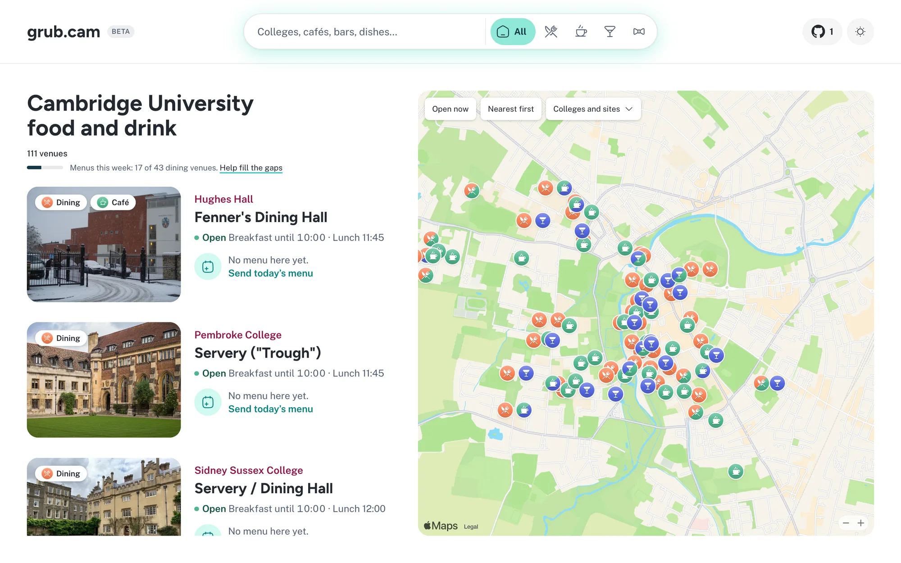
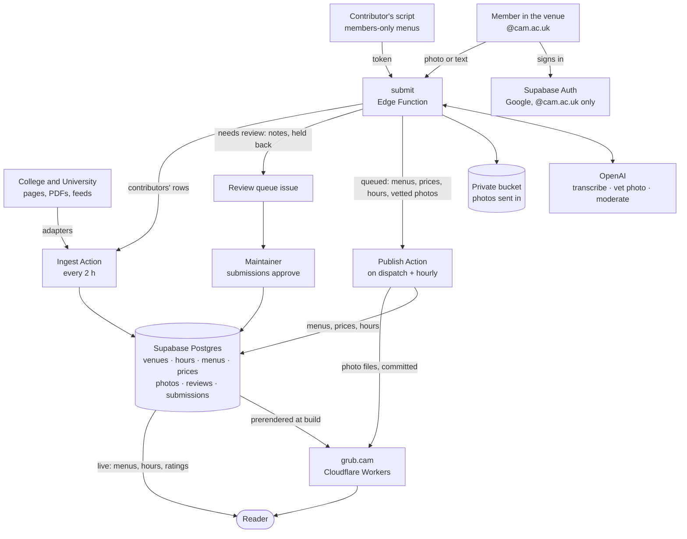

# grub.cam: Cambridge college menus, live

**Where can I eat in Cambridge right now, and what's on?**

Grub lists the dining halls, cafés and bars of all 31 Cambridge colleges, and the University's own cafés and canteens (West Cambridge, Sidgwick, the UL, the museums and more), with opening hours, prices and the menu dish by dish wherever one is published. What's open now comes first; filter by type, college or site, meal or diet, or search for a dish.

[](https://grub.cam)

Live at [grub.cam](https://grub.cam). See [AGENTS.md](AGENTS.md) for commands, data rules and links to the design and operations guides, and [CONTRIBUTING.md](CONTRIBUTING.md) for ways to help.

## How information gets in

Two routes fill the same Supabase database. Menus a college or the University publishes on the open web are fetched by scripts. Everything else (members-only menus, price lists, opening hours, photos of venues) comes from members of the University standing in the venue, signed in with their Cambridge account. A model reads what they send, and what goes up straight away is limited to what a check can vouch for.



What happens to each thing a member sends, from [`/send`](https://grub.cam/send) or a gap on a venue's page:

| Sent in | The model | Then |
|---|---|---|
| **Menu** (photos or PDFs of the board, up to 10, or typed; a note for context) | Reads it into the menu text format as the sender watches, and decides whether it can go up as it is; if not, tells the sender what to send instead | Up within minutes when the model is confident, it parses, is for that venue, is dated yesterday or later, and the venue's menu isn't scripted; otherwise a person looks |
| **Price list**, **hours** | Reads them, given what the site lists now, so part of a board or a typed change comes back as the whole list, and decides whether they can go up; if not, tells the sender what to send instead | Up within minutes when it parses and is for that venue; what it replaced is kept, and `npm run submissions -- reject <id>` puts it back |
| **Photo of the venue** | Checks it's a real photo of the venue with no recognisable face, and writes its alt text | Up within minutes when it passes and no other member's photo of the venue went up that day (no limit on one member's), credited to the member's name under CC BY 4.0; the venue keeps its old photo until the new one's files are deployed |
| **Review** (1–5, optional words) | A rating alone goes straight up; words go through OpenAI's moderation and a check that they're about the venue and name no one | Shown anonymously once a venue has 5 |
| **Correction** (“Report a change”: hours, prices, menu, formal hall, diet, location, closed) | — | A person reads it; hours, prices and menus are steered to their own kinds, which go up by themselves |

Everything goes up under the sender's name (the name their Cambridge account gives), on the venue's page and on [Contribute](https://grub.cam/contribute), where members are ranked by what they've filled in. Nothing a model is unsure of goes up unseen: whatever doesn't pass waits, with the reason, in the [Review queue](../../issues?q=is%3Aissue+is%3Aopen+%22Review+queue%22) issue. Model calls are logged with their cost. With an enforced OpenAI project spend limit, reaching it stops further model calls and sends anything needing a model check to a person; setting only an alert threshold does not stop calls.

## Run it

```sh
npm install
cp .env.example .env   # add the Supabase URL and publishable key
npm run dev
```

`npm test`, `npm run typecheck`, `npm run lint`; `npm run build` prerenders every page from live data.

## Switching on sending in

Google sign-in was switched on on 12 Oct 2026. These are the steps, for setting it up again or on another project.

Reading needs no account and no keys beyond the publishable one. Sending in needs three things set up once:

1. **Google sign-in.** Every member has a CRSid@cam.ac.uk Google account, and signing in with it is the University's own route for a site outside UIS ("Raven OAuth2", [UIS's guide](https://docs.raven.cam.ac.uk/en/latest/creating-oauth2-client-credentials/)): a college or personal site registers with an ordinary Google account (UIS recommends a shared one tied to a role address), with no approval. In [console.cloud.google.com](https://console.cloud.google.com), create a project, then in Google Auth Platform:
   - *Branding*: app name Grub, a support email, home page `https://grub.cam`, privacy policy `https://grub.cam/terms`, authorised domains `grub.cam` and `leghyhbkovkyipgoygko.supabase.co`. No logo: one needs Google's brand verification.
   - *Audience*: External, then **Publish app**. While it's in Testing only listed test users can sign in; asking only for the basic scopes, publishing needs no verification.
   - *Data access*: `openid`, `.../auth/userinfo.email` and `.../auth/userinfo.profile` only.
   - *Clients* → Create client → Web application, authorised redirect URI `https://leghyhbkovkyipgoygko.supabase.co/auth/v1/callback`. Copy its Client ID and Client secret.

   Put them as `GOOGLE_CLIENT_ID` and `GOOGLE_CLIENT_SECRET`, and a Supabase [personal access token](https://supabase.com/dashboard/account/tokens) as `SUPABASE_ACCESS_TOKEN`, in `.env`, then `npm run auth:google`. It turns the provider on and sets the site and redirect URLs (`-- --check` shows what's set); pasting the ID and secret into the dashboard (Authentication → Sign In / Providers → Google) and setting URL Configuration by hand does the same. The site's **Sign in** appears by itself once it's on, and asks Google for the cam.ac.uk account; whatever account someone picks, the database refuses any address that isn't `@cam.ac.uk`. If a member is told their institution blocks the app, ask UIS (raven-support@uis.cam.ac.uk) to allow its client ID: it asks for nothing beyond the sign-in scopes.

   Microsoft (Entra) was the first plan, but UIS registers apps for Cambridge's tenant itself and adds them to an allowlist, so an outside app likely needs their approval, and the maintainer's account can't register apps; it stays an option if UIS ever takes it on.
2. **The models.** `supabase secrets set OPENAI_API_KEY=…`. Boards, price lists and hours are read by `gpt-6.1-sol` (`OPENAI_MODEL`); photos and reviews are checked by `gpt-6-luna` (`OPENAI_CHECK_MODEL`). Their prices are built in, so spend is counted; for any other model set `OPENAI_PRICE` / `OPENAI_CHECK_PRICE` ("2/10", dollars per million input/output tokens), and compare on real boards with `npm run models:compare`. In the OpenAI project's Limits → Spend, set a monthly spend limit and enable **Enforce a hard limit**. An alert threshold alone does not cap spending ([OpenAI's guide](https://developers.openai.com/api/docs/guides/spend-limits)). The application has no monthly cap; `LLM_DAILY_USD` optionally checks daily spend before calls. Optional: `OPENAI_REASONING`, `IP_SALT`. If the OpenAI project allows only selected models, allow those two and `omni-moderation-latest`. Without a key, transcriptions and photo/review checks wait for a person; rating-only reviews need no model.
3. **The Actions' clock.** Supabase's pg_cron starts the three Actions (ingest every two hours, publishing hourly, the review queue at 07:00 and 18:00 UTC), and the submit function starts publishing the moment a menu or photo is queued: GitHub's own cron ran late or not at all on this repo. Both use a fine-grained GitHub token with *Actions: read and write* on this repo only, kept in Vault as `github_dispatch_token`: Integrations → Vault → Add new secret (or `select vault.create_secret('github_pat_…', 'github_dispatch_token');` in the SQL editor, which keeps the query in its history). Set an expiry and renew it: once it lapses, GitHub answers 401 and nothing scheduled runs. Without it nothing scheduled runs. `select jobname, schedule from cron.job;` lists the schedules, and `select created, status_code from net._http_response order by created desc limit 5;` shows GitHub's last answers (204 is a start). All three Actions need repository secrets `VITE_SUPABASE_URL` and `SUPABASE_SECRET_KEY`; the ingest Action also uses `CF_DEPLOY_HOOK` to rebuild the site.

`npm run submissions -- smoke [--photo venue.jpg] [--review]` then checks the submission API without Google: a throwaway `@cam.ac.uk` account (no email is sent) sends a menu, and optionally a photo and a review, through the deployed function, and removes the account, submissions and evidence afterwards (model-call logs remain). It does not test Google sign-in or the publishing/deploy cycle.

## Data

- Everything lives in Supabase. Menus are fetched from public college and University sources every two hours (`scripts/ingest`), transcribed from PDFs and image menus, or sent in by members, and re-published with attribution.
- [`scripts/ingest/sources.ts`](scripts/ingest/sources.ts) records how each venue publishes its menu.
- Photos of venues are our own, members', or openly licensed from Wikimedia Commons, each credited ([grub.cam/credits](https://grub.cam/credits)).
- Something wrong? [Open an issue](https://github.com/giuulio/grub.cam/issues), or "Report a change" on the venue's page.

## Roadmap

- Editors per college or site, and a web view of the review queue
- Menus from more contributors for members-only colleges
- Dish history, favourites and alerts
- Dated hours overrides (closures, vacations)

## Licence

The code is © Giulio Orlandi under the [GNU AGPL v3](LICENSE): you may run, change and share it, but if you run a changed copy as a service, you must offer its users the source under the same licence. Contributions are accepted under the same terms.

The licence covers the code only. Photos in [`public/photos`](public/photos) keep their own licences and credits ([grub.cam/credits](https://grub.cam/credits)); menus, hours and prices belong to the colleges and the University that publish them; the fonts come from their npm packages under the SIL Open Font License.
